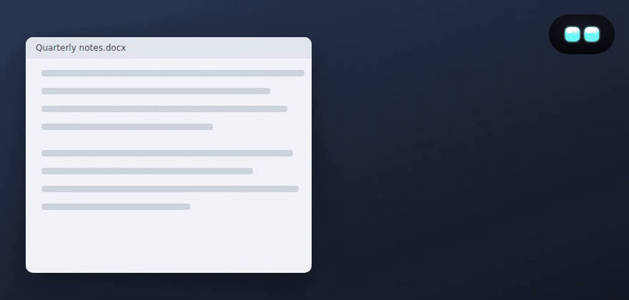
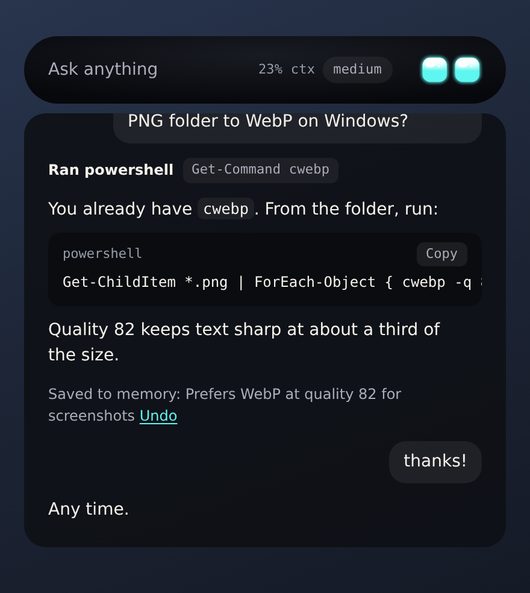
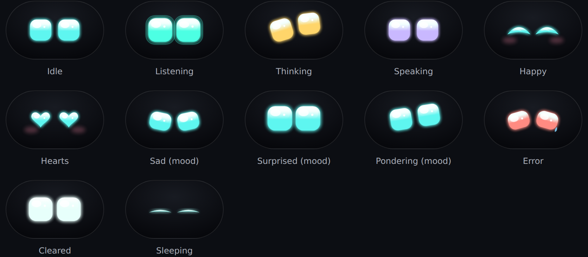

  <picture>
    <source media="(prefers-color-scheme: dark)" srcset="docs/brand/lockup-light.svg">
    
  </picture>

A desktop assistant that lives as a pair of eyes at the edge of your screen.

  
  
  
  

  

Press a key to type, or hold it to talk. Winku answers in text or out loud. It can look at the window you're using, run things for you, and rewrite selected text in place. It keeps one conversation going until you clear it.

There is no account and no telemetry. Winku talks only to the model provider you choose and, if you add a key, Brave Search.

> [!NOTE]
> Winku is early: version 0.x, Windows only, and the installer isn't code-signed yet. Expect rough edges, and please [report them](https://github.com/RyderAsKing/Winku/issues/new/choose).

## Install

Windows 10 and 11 for now. Linux and macOS come later.

1. Download `Winku_<version>_x64-setup.exe` from the [latest release](https://github.com/RyderAsKing/Winku/releases/latest).
2. Run it. Because the installer isn't signed, Windows SmartScreen may say it "protected your PC". Choose **More info**, then **Run anyway**.
3. The eyes appear at the edge of the screen. Press `Ctrl+Alt+Space` and connect a model: pick a provider, paste an API key, choose a model and press Test.

Winku updates itself from GitHub Releases. It checks each update against Winku's signing key, then installs it when you quit or restart. You can switch this to "Tell me" or "Off" in Settings > App.

## Use it

| Keys | Does |
|---|---|
| tap `Ctrl+Alt+Space` | open or hide the bar |
| hold `Ctrl+Alt+Space` | talk; let go to send. Holding also stops Winku speaking |
| `Ctrl+Alt+1`–`5` | run an action on the selected text |
| `Ctrl+Alt+Q` | ask about the selected text |
| `Ctrl+Alt+S` | attach a screenshot of the current window |
| `Ctrl+Alt+X` | clear the conversation (Undo for 5 seconds) |
| `Ctrl+Alt+T` | change how hard the model thinks |
| `Esc` | stop the reply or the speech; press again to hide the bar |
| `Ctrl+J` | show or hide the transcript, the whole conversation |

You can change every key in Settings. If `Ctrl+Alt` types characters on your keyboard layout (AltGr), Settings offers `Ctrl+Shift` instead. You can also set a leader key such as F13.

- **Actions.** Select text in any app and press `Ctrl+Alt+1`. The defaults are Rewrite, Fix grammar, Shorter (each replaces the selection, and `Ctrl+Z` in that app undoes it), Explain (shows in the bar) and Do it (runs it as a task with tools). You can edit all five.
- **Tools.** Winku can read and write files in your home folder, run PowerShell, open files, apps and web pages, read web pages and look at the window you were using. Turn on Settings > Tools > "Ask before running" to approve each change first.
- **Voice.** The first time you hold the talk key, Winku downloads a speech model of about 110 MB and shows the progress on the eyes. Your speech is recognised on your computer and never leaves it. When you spoke, Winku reads the reply aloud in a natural offline voice (Supertonic, an 85 MB download on first use). The Windows voice reads until Supertonic arrives, and stays available in Settings.
- **Memory.** Winku saves things worth remembering as plain markdown files, and each reply shows what it saved, with an Undo. Settings > Memory and voice opens the folder, the "About me" file and your writing voice profiles.
- **Right-click the eyes** for Settings, History, Ask before running, Hide eyes, Pause listening and Quit.

  

## The eyes

The eyes show what Winku is doing. They turn teal while you talk, amber while the model thinks, and lavender while it answers. They close into happy arcs when a reply lands, and slowly fall asleep when nothing has happened for a while. The lids droop a little as the conversation fills the model's context, so you can tell when it's time to clear it. Behind them, a grid of dots lights up with what Winku is doing: rings while you talk, specks drifting off while it thinks, a voice meter while it speaks.

  

## Your data

Everything lives in `%APPDATA%\winku`: settings, conversations and history, memory, voice profiles and downloaded speech models. Winku keeps API keys in Windows Credential Manager, never in a file. Nothing goes anywhere except to your model provider, and to Brave Search if you added a key.

## Contributing

Bug reports and ideas are welcome in [Issues](https://github.com/RyderAsKing/Winku/issues/new/choose). If you'd like to send a pull request, open an issue first so we can agree on the change. [CONTRIBUTING.md](CONTRIBUTING.md) covers building from source and running the tests. [docs/SPEC.md](docs/SPEC.md) describes what Winku does, and [docs/ARCHITECTURE.md](docs/ARCHITECTURE.md) how it's built.

Found a security problem? Please report it privately, as [SECURITY.md](SECURITY.md) explains.

## License

[MIT](LICENSE)

Winku bundles [agent-desktop](https://github.com/vercel-labs/agent-desktop) (Apache-2.0) for computer use. Its licence is in [app/src-tauri/licenses/agent-desktop.txt](app/src-tauri/licenses/agent-desktop.txt) and is installed alongside the app. The wordmark is set in [Nunito](https://github.com/googlefonts/nunito) (SIL Open Font License).
