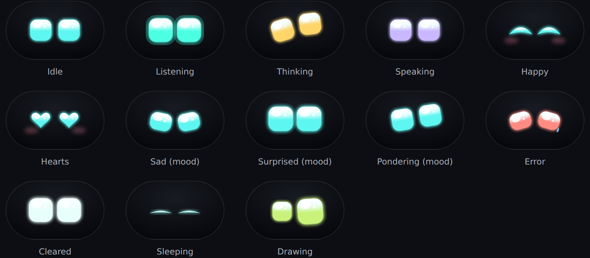

# The eyes

The eyes show what Winku is doing. They turn teal while you talk, amber while the model thinks, lavender while it answers, and lime while it draws a visual. They close into happy arcs when a reply lands, and slowly fall asleep when nothing has happened for a while.

  

- **Context.** The lids droop a little as the conversation fills the model's context, so you can tell when it's time to clear it.
- **Thinking level.** At rest, the colour shows how hard the model thinks: pale mint when off, through cyan, to indigo at the most. `Ctrl+Alt+T` changes it, and the eyes hop when it goes up.
- **The dot field.** Behind the eyes, a grid of dots lights up with what Winku is doing: rings while you talk, specks drifting off while it thinks, a voice meter while it speaks.
- **Quiet.** The eyes never start a conversation. They only speak up for an error or a scheduled task you asked for.

You can make them Small, Medium or Large, or hide them, in Settings > Eyes.
