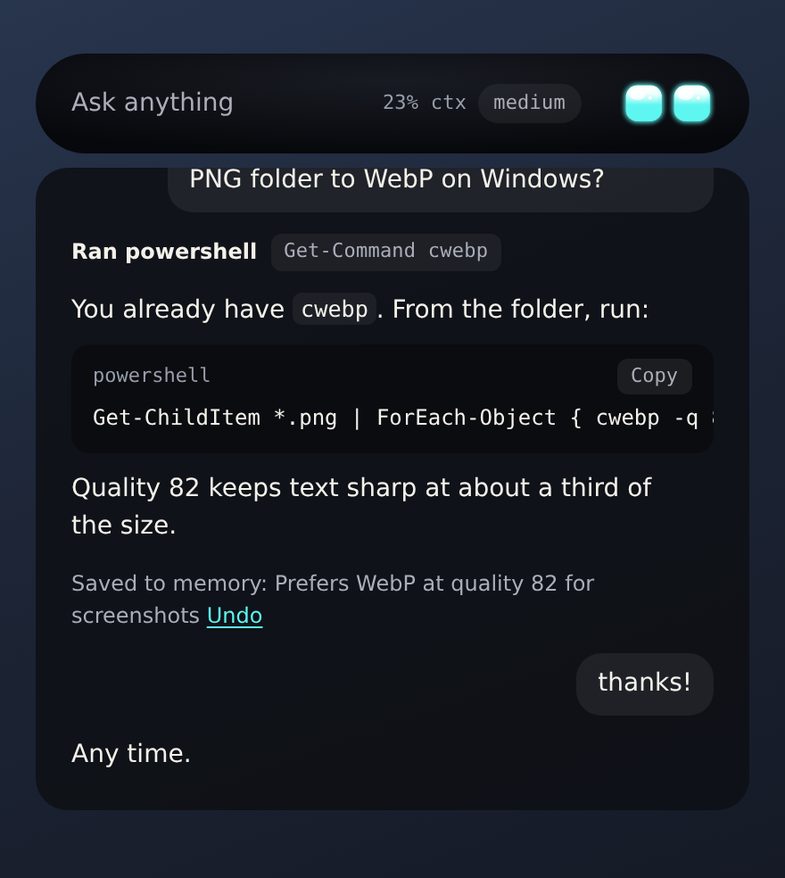

# Using Winku

## Keys

| Keys | Does |
|---|---|
| tap `Ctrl+Alt+Space` | open or hide the bar. With text selected in another app, it brings that text to the bar instead, open or not |
| hold `Ctrl+Alt+Space` | talk; let go to send. Holding also stops Winku speaking |
| `Ctrl+Alt+1`–`5` | run an action on the selected text |
| `Ctrl+Alt+Q` | ask about the selected text |
| `Ctrl+Alt+S` | attach a screenshot of the current window |
| `Ctrl+Alt+X` | clear the conversation (Undo for 5 seconds) |
| `Ctrl+Alt+T` | change how hard the model thinks |
| `Esc` | stop the reply or the speech; press again to hide the bar |
| `Ctrl+J` | show or hide the transcript, the whole conversation |

You can change every key in Settings. If `Ctrl+Alt` types characters on your keyboard layout (AltGr), Settings offers `Ctrl+Shift` instead. You can also set a leader key such as F13.

## The transcript

Winku keeps one conversation going until you clear it. The bubble under the bar shows the latest reply; scroll up over it, or press `Ctrl+J`, to see the whole thread.

  

## Visuals

When a picture says more than words, Winku draws a visual into its reply: a chart, a table or a diagram. You can ask for one, or it draws one on its own. Most replies stay text.

While it draws, the eyes turn lime and the bubble shows a shimmering "Drawing" line. Click a visual to see it larger, or pick "Open in browser" to see it in your browser. Press `Esc` to step back, or click elsewhere with the bar open. It stays in the thread, so the transcript keeps it. A visual can load pictures or scripts from the web, the way a web page does. Nothing about you is sent with them.

## Actions

Select text in any app and press `Ctrl+Alt+1`. The defaults are Rewrite, Fix grammar, Shorter (each replaces the selection, and `Ctrl+Z` in that app undoes it), Explain (shows in the bar) and Do it (runs it as a task with tools). You can edit all five in Settings > Actions.

You don't need an action key to work on a selection. Select text, open Winku with `Ctrl+Alt+Space` (or hold it and talk), and say what you want: "google this and check the facts". The selection shows in the bar as a pill; click its × to leave it out. In terminals, and in editors that have a built-in terminal (VS Code, JetBrains IDEs), use `Ctrl+Alt+Q` instead, because Winku won't press `Ctrl+C` there for you.

## More providers

Settings > Model > Provider extensions adds a pi package that brings more model providers. For example, paste `https://github.com/earendil-works/pi-claude-code` to use your Claude Pro or Max subscription through Claude Code: install Claude Code, run `claude auth login` once, then pick "Claude Code Subscription (Experimental)" as the provider. It needs no key. Only add extensions you trust, since they run on your computer. Winku uses only the providers an extension adds, not its other features.

## Tools

Winku can read and write files in your home folder, run PowerShell (bash on Linux), open files, apps and web pages, read web pages and look at the window you were using. Turn on Settings > Tools > "Ask before running" to approve each change first.

## Voice

The first time you hold the talk key, Winku downloads a speech model of about 110 MB and shows the progress on the eyes. Your speech is recognised on your computer and never leaves it.

When you spoke, Winku reads the reply aloud in a natural offline voice (Supertonic, an 85 MB download on first use). The Windows voice (on macOS its own `say`; on Linux, Speech Dispatcher's `spd-say`, if it's installed) reads until Supertonic arrives, and stays available in Settings.

## Memory

Winku remembers you between conversations. It keeps a short profile of lasting facts about you, your current goals and a recap of where you left off, and it always has them in front of it, so you don't have to repeat yourself. Things worth keeping go into notes, and before each message Winku looks through them and brings along the ones that relate. That search runs on your computer, with a 34 MB model downloaded the first time it's needed.

Winku saves on its own and when you say "remember…", and each reply shows what it saved, with an Undo. After a conversation goes quiet or you clear it, Winku also tidies up: it updates the profile and goals, adds notes worth keeping and writes the recap.

It's all plain markdown. Settings > Memory and voice lets you edit the profile, goals and recap, delete notes, run a tidy, see the notes as a map (each topic a hub, with dotted lines between related notes in different topics), try a message to see exactly what Winku would add to it (and which notes came close but were left out, and why), open the folder and the "About me" file, and pick your writing voice profiles. Both the search and the tidying can be turned off there.

## The right-click menu

Right-click the eyes for Settings, History, Ask before running, Hide eyes, Pause listening and Quit.

## Updates

Winku updates itself from GitHub Releases. It checks each update against Winku's signing key, then installs it when you quit or restart. You can switch this to "Tell me" or "Off" in Settings > App.

## Linux

Winku talks to the X server ([why](adr/0003-linux-runs-on-x11.md)). In an X11 session everything above works. In a Wayland session Winku runs through XWayland, which changes a few things:

- **Apps that run natively on Wayland are invisible to Winku.** Most GTK 4 and Qt 6 apps do, and so do Firefox and Chromium-based browsers when they're set to. With one of them in front, Winku doesn't know which app you're in, can't read your selection or paste a result back, and can't take a screenshot. Apps that run through XWayland (many Electron apps, older GTK 3 and Qt 5 apps, games) work normally. Choosing the X11 session at the login screen ("GNOME on Xorg", "Plasma (X11)") gives you everything.
- **Hotkeys on GNOME** only reach Winku while an XWayland app has focus. KDE Plasma passes them on when its setting for legacy X11 apps allows them to read keystrokes (System Settings, Application Permissions or Window Management, depending on the version).
- **Computer use** reads apps through the accessibility bus (AT-SPI), on X11 and Wayland alike. Chromium and Electron apps show up there only when started with `--force-renderer-accessibility`, and Qt apps with `QT_LINUX_ACCESSIBILITY_ALWAYS_ON=1`.

A few things differ on Linux whatever the session:

- **The clipboard.** X11 has no clipboard store: the app that copied keeps the data. What Winku copies stays available while it runs, or longer if your desktop has a clipboard manager (most do).
- **Terminals** copy and paste with `Ctrl+Shift+C` and `Ctrl+Shift+V`, and Winku uses those in them. xterm and urxvt don't have those shortcuts, so rewriting a selection doesn't work there.
- **API keys** are kept in the Secret Service (GNOME Keyring or KWallet). Without a running keyring Winku can't save a key.
- **The tray icon** needs a status-notifier host. GNOME shows it only with the AppIndicator extension, which Ubuntu turns on by default.
- **Updates.** The AppImage updates itself like the Windows app. The `.deb` and `.rpm` ask for your password (through `pkexec`) to install an update.

## macOS

The Mac app is an unsigned preview ([why](adr/0004-macos-unsigned-build.md)): it hasn't been tried on a real Mac yet, so please [report](https://github.com/RyderAsKing/Winku/issues/new/choose) whatever doesn't work. The README says how to get past Gatekeeper the first time.

- **Keys.** Winku's `Alt` is Option and `Super` (or `Win`) is Cmd, so the summon key is `Ctrl+Option+Space`. macOS uses `Ctrl+Option+Space` to switch input sources when you have more than one; if it does on your Mac, pick another summon key in Settings > Keys.
- **Permissions.** macOS asks for each one the first time Winku needs it. You can turn them on or off later in System Settings > Privacy & Security:
  - **Accessibility** (asked at the first start): reading your selection, pasting a result back, and computer use.
  - **Screen Recording**: screenshots of the window you're in, and window titles.
  - **Microphone**: talking to Winku.
  - **Input Monitoring**: the hotkey hints that appear while you hold a key's modifiers.

  Without one of them, that feature does less and the rest keeps working. Because the app isn't signed with a Developer ID, macOS forgets these permissions when Winku updates, and asks again.
- **Copy and paste** use Cmd+C and Cmd+V, in terminals too (Cmd+C never interrupts a program on a Mac), so the summon key reads the selection there as well. They are sent as the keys where C and V sit on a US keyboard.
- **The clipboard.** When Winku puts your clipboard back after reading a selection or pasting, it marks it as transient, so clipboard managers don't record the copy twice. Content a password manager marks as concealed is never kept or read. Clipboard history checks for new copies a few times a second.
- **Fullscreen apps** live in a Space of their own, and the eyes stay out of it.
- **Voices.** The "system" voice is the Mac's own speech (`say`), in the voice you pick from the ones installed in System Settings > Accessibility > Spoken Content.
- **API keys** are kept in your login Keychain.
