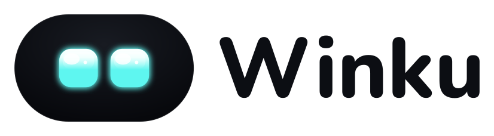

# Winku brand

<picture>
  <source media="(prefers-color-scheme: dark)" srcset="lockup-light.svg">
  
</picture>

Winku's brand is the eyes. The logo is the eyes peeking over the edge of your screen, the colours come from the eye states, and the words stay plain so the eyes can carry the personality.

## Peek, the logo

The logo is the resting pill cut off by a short line, the edge of the screen, with the eyes glancing sideways toward the name. The name sits on the same line. It says the tagline without words: Winku lives at the edge of your screen and keeps an eye out.

| File | Use on |
|---|---|
| [lockup-light.svg](lockup-light.svg) | dark backgrounds |
| [lockup-dark.svg](lockup-dark.svg) | light backgrounds |
| [peek.svg](peek.svg) | the pill alone, eyes glancing up, for pictures where a real edge does the cutting |

- The edge line runs only under the pill, a little past each end. It is not an underline, so never extend it under the name.
- The eyes always look toward the name, or up at whatever sits above them. They never look away from it.
- Where a picture has a real edge, such as the bottom of the [social card](social-card.png), let that edge cut the pill and drop the line.
- Leave clear space around the logo of at least half the visible pill's height.

## The mark

[mark.svg](mark.svg) is the whole resting pill, uncut and looking straight ahead, at the large size: the dark pill with two glossy, rounded-square eyes in the idle tint. Its geometry comes straight from `app/ui/src/lib/eyes/Eyes.svelte`, scaled up, so the logo and the app always match. If the eyes change shape, change the mark and the Peek files too.

Use the mark where Peek would be too small to read: app icons, the installer, the tray, favicons and avatars. The app icons in `app/src-tauri/icons/` are rendered from it.

- Use it as it is. Don't recolour the eyes, swap in another eye state, add an outline or put it in a box.
- The face is always dark, on light and dark backgrounds alike, just as in the app.

## The wordmark

"Winku", with a capital W, set in [Nunito](https://github.com/googlefonts/nunito) ExtraBold (800) with the font's default kerning and outlined to paths: [wordmark-light.svg](wordmark-light.svg) for dark backgrounds, [wordmark-dark.svg](wordmark-dark.svg) for light ones. Use it alone only where the eyes are already in the picture, as on the social card. In the logo its cap height is a little under half the full pill's height.

In text, write "Winku", never "WINKU" or "winku" (except in file paths and code).

Nunito is only for the wordmark and brand pictures such as the social card. The app's own text uses the system font (Segoe UI Variable on Windows). Nunito's licence is in [fonts/OFL.txt](fonts/OFL.txt).

## Colours

| | Hex | Where |
|---|---|---|
| Winku cyan | `#5EF6F0` | the brand colour: idle eyes at the default thinking level, the app's accent |
| Face, top | `#181B22` | the pill's face gradient |
| Face, bottom | `#07080C` | |
| Panel | `#0C0E13` | backgrounds, the dark wordmark ink |
| Text | `#F4F1EA` | text on dark, the light wordmark ink |
| Muted | `#AAAEB9` | secondary text |

The eye states have their own colours: listening teal `#4CFFE3`, thinking amber `#FFD56A`, speaking lavender `#C9B8FF` and error coral `#FF8B82`. They belong to the states. Use them to show a state, never as general brand colours.

The eyes glow. Nothing else does: no glow, gradients or sparkles on text, buttons or backgrounds.

## Voice

Winku's text is warm but plain. The eyes are where the charm lives, so the words don't need to try.

- Say what Winku does, with keys and numbers: "Hold `Ctrl+Alt+Space` to talk" rather than "Chat naturally with your new AI buddy".
- Short sentences, everyday words, and no exclamation marks.
- No emoji, in the app or in the docs.
- Don't call Winku "cute" or describe its personality. Show it in a picture or a GIF instead.
- Be honest about limits: Windows only for now, unsigned installer, early version.
- Use the words in [GLOSSARY.md](../../GLOSSARY.md): the eyes, the bar, the bubble, the transcript, the thread. "Pill" is only the name of the shape, not something to call Winku in user-facing text.

Tagline: **A desktop assistant that lives as a pair of eyes at the edge of your screen.**

## Files and how to rebuild them

The SVGs are the sources. After editing them, run this from `app/`:

```sh
bun run brand
```

It renders [mark.png](mark.png) (1024 px), the social card [social-card.png](social-card.png) (1280×640, from [social-card.html](social-card.html)) and the app icons in `app/src-tauri/icons/`.

The README's demo GIF and pictures in `docs/media/` come from the UI running on the mock shell:

```sh
bun run ui:dev          # in one terminal
bun run readme-media    # in another; needs ffmpeg
```

After changing the social card, upload `social-card.png` in the repository's Settings > General > Social preview. GitHub has no API for it.
